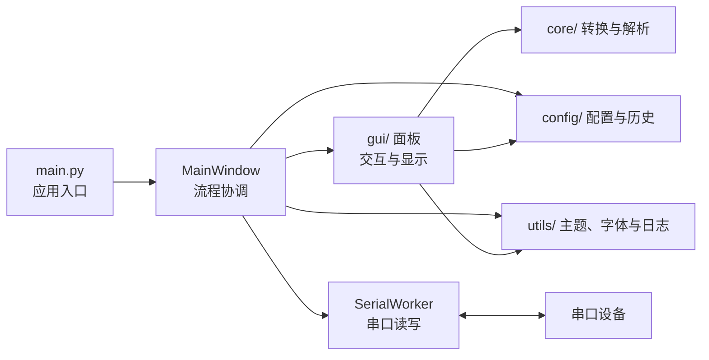

# easycom 框架说明

## 1. 总览

easycom 是基于 PySide6 的 Windows 桌面串口调试工具，使用 pyserial 访问串口。界面由多个面板组成，`MainWindow` 负责连接面板信号、管理串口连接、切换接收模式及协调日志；串口读取由 `SerialWorker` 的后台线程完成。用户配置和历史记录保存为 JSON 文件。



## 2. 目录与职责

| 路径 | 职责 |
| --- | --- |
| `main.py` | 创建 `QApplication`，加载内置字体，创建 `MainWindow`，应用主题和已保存设置，进入 Qt 事件循环。 |
| `gui/main_window.py` | 组装界面，连接信号，处理连接生命周期、自动重连、接收队列消费、模式切换和自动保存会话。 |
| `gui/serial_config_panel.py` | 端口、波特率等串口参数及连接控制。 |
| `gui/send_panel.py`、`gui/ext_cmd_panel.py` | 普通发送、定时发送、发送历史和扩展命令；向主窗口发出待发送的 `bytes` 和本次是否使用 HEX 模式。 |
| `gui/receive_panel.py`、`gui/terminal_receive_panel.py` | 分别处理普通日志式接收显示和终端控制序列显示。终端面板在首次需要时创建。 |
| `gui/` 其他文件 | 状态栏、标题栏、对话框、按钮及其他界面组件。 |
| `core/serial_worker.py` | 打开/关闭串口、读写字节、维护接收队列，并通过 Qt 信号报告状态。 |
| `core/data_converter.py`、`core/ansi_parser.py` | 字节与十六进制转换、时间戳格式化、换行处理及 ANSI 文本片段解析。 |
| `config/` | 默认值、运行限制、主题和界面常量，以及设置与历史记录的持久化。 |
| `utils/` | 主题应用、字体加载和回退、异步日志写入。 |
| `resources/`、`icon/` | 内置字体、图标等打包资源。 |
| `scripts/` | 环境初始化、清理、打包和发行脚本。 |

## 3. 启动与界面装配

1. `main.py` 创建 `QApplication`，随后通过 `utils/font_manager.py` 加载 `resources/fonts/` 中的字体。
2. `MainWindow` 创建串口配置、普通接收、发送、扩展命令及状态栏等组件，并连接它们的 Qt 信号。主界面中，普通接收区和终端接收区共用一个 `QStackedWidget`；扩展命令区位于右侧 `QSplitter` 中。
3. 入口根据 `config.app_config.config` 恢复主题、字号、编码、发送选项及窗口状态。若上次使用终端模式，主窗口在界面显示后切换模式并创建终端面板。

## 4. 串口数据流

### 接收

```text
串口设备 → SerialWorker.run() → 加锁的接收队列 → received_ready 信号
         → MainWindow._drain_received() → 当前接收面板 → 状态栏/自动日志
```

后台线程批量读取驱动已缓存的字节。缓冲区为空时，线程等待首字节，到达后立即返回并记时。读取超时为 50 毫秒，便于空闲时响应关闭请求；等待期间发送和控制线操作可继续执行。

`SerialWorker` 读取字节后连同读取时间和每字节耗时估计放入队列，不直接更新界面。`MainWindow` 在 UI 线程中按 `config/runtime.py` 定义的时间与字节预算分批取出数据，并交给当前模式的接收面板。普通模式按行显示，可处理编码、时间戳、搜索和高亮。文本接收按 CR、LF 或 CRLF 分行，未换行的缓存空闲 100 毫秒后显示；HEX 接收保留全部原始字节，不按 `0D`、`0A` 或 `0D 0A` 分行，仅在连续 50 毫秒没有新数据时将缓存作为一行显示。终端模式解释终端控制序列。队列仍有数据时，主窗口会安排下一轮消费，避免大量接收数据长时间占用 UI 线程。

普通接收区和终端区均支持鼠标左键双击正文按 Qt 默认规则选词、三击选中当前逻辑行，包含时间戳但不包含行尾换行符；自动折行仍按同一逻辑行选择，空行只定位并高亮当前行。选区、行号和当前行高亮不会延伸到下一行。普通拖选、键盘选区、搜索及发送输入区行为保持不变。

### 发送与连接

`SerialConfigPanel` 发出打开、关闭或重新配置请求，由 `MainWindow` 调用 `SerialWorker`。连接状态通过 `state_changed` 信号返回主窗口，再更新面板和状态栏。自动重连由主窗口的定时器协调。

`SendPanel` 将输入按文本/十六进制模式、发送编码和换行设置转换为 `bytes`；扩展命令面板按每行的设置转换。两个面板发送时都携带本次是否使用 HEX 模式。`MainWindow._on_send()` 检查连接状态后调用 `SerialWorker.send()`，发送数量经 `sent` 信号更新状态栏。普通模式可按设置把发送内容回显到接收区：文本发送使用 `TX->>>` 前缀，HEX 发送使用 `HEX TX->>>` 前缀并显示大写、空格分隔的十六进制字节（包含追加的换行字节）。回显格式由本次发送模式决定，与接收区的 HEX 显示开关无关；终端模式继续由设备回显。

`SendPanel` 展开发送历史时读取普通发送与扩展命令共用的历史列表，并按“文本 + HEX + CRLF”复用行控件：新增只创建新行，再次发送已有命令只调整位置，删除与超限淘汰同步移除对应行。历史变化时在弹出前同步固定菜单高度，确保新增历史在首次展开时即可完整显示。历史未变化时直接复用菜单；主题或可用尺寸变化时重建。历史仍最多保留 99 条，菜单最多显示 16 行，其余通过滚动查看。

## 5. 配置、日志与资源

- `config/app_config.py` 提供全局 `config` 及串口、搜索、发送等历史记录辅助对象。源码运行时，数据写入项目根目录的 `auto-gen/`；打包后写入可执行文件同级的 `auto-gen/`。
- 扩展命令配置存放在 `auto-gen/cmd/`。运行时生成的配置、历史记录和日志不属于源码。
- 自动保存会话由 `MainWindow` 创建和结束，文件写入由 `utils/file_logger.py` 中的 `AsyncLogWriter` 异步执行；普通接收与终端接收面板分别提供日志内容。
- 字体默认值及回退顺序位于 `config/ui.py`，加载与使用方法集中在 `utils/font_manager.py`。`scripts/build_exe.py` 将 `resources/` 和 `icon/` 一并打包。

### 关键运行诊断日志

程序启动后自动写入 `auto-gen/diagnostics/runtime.log`，旧文件为 `runtime.log.1`。源码运行时位于项目目录下，打包后位于 exe 同级的 `auto-gen/`。两份文件各最多 524,288 字节，总上限 1,048,576 字节（1 MiB），按 UTF-8 实际字节数计算；轮转时淘汰最旧文件，超长记录截断并标记。此限制只适用于诊断日志，原有串口接收数据自动保存不受影响。

诊断由 `utils/diagnostics.py` 异步写入，只记录启动/退出、连接与断连、重连阶段变化、串口异常、线程退出超时、接收积压、自动保存失败和 Python/Qt 异常。不记录收发载荷或逐次轮询。同类故障首次记录，后续最多每 30 秒汇总一次，恢复或退出时补记次数；写入队列有上限，满时丢弃旧记录并汇总数量。致命错误同步刷新；写盘失败仅提示一次，不阻止串口使用。不会生成原生崩溃转储，系统级崩溃或强制结束可能丢失最后尚未写入的记录。

闪退后请先保留两个诊断文件，提供大致发生时间、普通/终端模式及断连重连等操作背景，再继续复现；持续运行会轮转掉旧记录。不要在取证前恢复默认或执行清理脚本。

串口异步打开按请求编号提交结果，同一时刻仅允许一次打开；关闭、重配会取消旧请求，迟到的句柄直接释放。自动重连等待旧线程结束，窗口退出等待打开和读取线程停止，超时保持窗口并继续等待，不强制销毁运行中的 QThread。接收队列仍按原预算消费，积压达到 8 MiB 时记录告警，不丢弃串口数据。发送失败会结束该连接并按现有设置处理重连，保留原有发送超时配置。

## 6. 修改入口

- 单个面板的布局或交互：修改对应的 `gui/*_panel.py`；跨面板流程和信号连接：修改 `gui/main_window.py`。
- 串口读写与接收队列：修改 `core/serial_worker.py`，保持 UI 更新在主线程执行。
- 字节转换或 ANSI 文本解析：优先检查 `core/data_converter.py`、`core/ansi_parser.py`；终端控制序列的界面行为位于 `gui/terminal_receive_panel.py`。
- 用户设置和历史记录：检查 `config/app_config.py` 及相关默认值；字体、主题和运行限制分别查看 `config/ui.py`、`config/theme.py`、`config/runtime.py`。

具体修改和验证要求见项目根目录的 [AGENTS.md](../AGENTS.md)。

## 7. 接收区搜索与关键字着色

两个接收面板共用 `gui/document_search.py` 调度搜索：查询输入保留 100ms 防抖，接收内容变化按 100ms 合并刷新，每批以 `config/runtime.py` 中的 `SEARCH_SLICE_BUDGET_MS`（默认 4ms）作为执行预算。普通文本按有上下文的文本块扫描，保留跨块匹配与全字边界；修改过的段落及其后续内容重新匹配，未受影响的前缀结果复用。达到缓存上限后，必要时重新扫描以补齐最近结果。查询、选项、清空和面板隐藏会使旧任务失效，重新显示面板时恢复当前查询。

搜索结果与绘制分离。移动光标、跳转匹配、改变颜色和滚动不会重新搜索全文；最多保留最近 9999 条非空匹配，首次导航定位到最后一条。高亮仅为可见位置附近生成，字号或窗口尺寸变化后重新计算可见范围。计数中的 `+` 表示结果已截断；无结果且仍在扫描时显示“搜索中…”，非法正则显示错误提示，详细原因可通过悬停计数查看。

匹配实现位于 `core/text_matching.py`。普通模式保留 Qt 正则语法和原有的全字/重叠文本匹配规则；终端保留 Python 正则语法及跨行支持，并修正正则与全字选项组合。两个引擎的 Unicode 单词边界规则并不完全相同，例如普通文本全字模式对下划线的处理。Python 匹配位置会转换为 Qt UTF-16 位置，避免 emoji 后高亮和导航错位。零长度正则匹配不计数、不着色。

终端正则采用完整文本快照，避免分块破坏跨行、回溯和前后文语义。连续追加时可以发布快照中未修改段落的结果，再继续更新；覆盖或删除会使运行中的扫描失效。匹配总数在更新完成前可能暂时落后于接收内容，悬停计数会显示正在更新。

`gui/keyword_highlighter.py` 通过可见文本块的 `QTextLayout` 格式层应用关键字前景色，不改写文档正文。规则匹配区间有有界缓存，仅更换颜色会复用区间；规则变化按需重新匹配可见内容，滚动后为新出现的内容着色。超长行也只处理可见范围及关键字长度所需的上下文。时间戳、发送回显和系统消息不参与关键字匹配，ANSI 样式保留优先级，搜索背景色与关键字前景色可以叠加。

普通文本行号沿可见块累计布局高度，复用第一行的实际位置和高度，避免为每个行号重复查询块几何和光标矩形；折行、字号和选区样式保持一致。

关键词高亮仅用于普通接收模式，终端模式保留自身的 ANSI 颜色和搜索高亮。完整文本片段直接读取，裁剪长行时仍使用 Qt 的 UTF-16 位置；水平和垂直滚动都会更新可见范围。匹配前用字面量包含检查排除确定未命中的关键词：区分大小写时直接检查，忽略大小写时仅对纯 ASCII 文本使用小写预筛选，Unicode 继续使用原正则规则。匹配仍逐词执行，保留重叠词的起点、长度和分组优先级。每处理 32 个关键词、命中或格式区间时允许调度让出。关键词高亮使用独立的 3 毫秒软预算（`KEYWORD_SLICE_BUDGET_MS`），搜索仍使用 4 毫秒预算；单次正则、排序或 Qt 布局调用不能中途打断。相同位置与分组的 Qt 格式区间复用至多 4096 个缓存项，规则或颜色变化时清空，减少密集命中的重复分配。一个文本块的格式准备完整且版本仍有效时才一次应用，避免分片过程中出现半行着色或写入过期结果。Qt 布局同步触发刷新时，旧任务按身份检查安全退出，由新任务接续，避免失效迭代器异常。

执行预算只约束两次匹配调用之间的工作，不能中断单次正则回溯、字符串处理或 Qt 排版。复杂正则、巨型单行，以及终端一次性装入大文本后的首次排版仍可能阻塞；本实现不提供独立进程硬超时，也不改变接收区的文档布局引擎。

高亮组件跨刷新保存的是随文档编辑自动调整的 `QTextCursor` 锚点，使用时再取当前文本块；不缓存跨清空操作的 `QTextBlock`。Qt 6.11.2 中旧块在大文档清空后仍可能通过 `isValid()`，随后访问 `layout()` 会产生原生访问冲突。普通接收区清空时记录开始（块数、缓冲字节数）与完成两条诊断日志，不记录文本内容。

### 关键词分组配置

“设置 → 关键字配置”默认提供 3 组，支持保留 1～10 组。分组列表可以滚动，末尾居中的 ➕ 和每组绿色启用按钮右侧的 ✖ 沿用扩展命令按钮样式；新增组默认禁用，删除后其余组按原顺序重新编号。达到 10 组时禁止新增，仅剩 1 组时禁止删除。

每组“清除”左侧的“展开”打开固定 720×520 的关键词编辑窗口，保留行号、当前行及文本选区高亮，每行一个关键词，支持纯文本多行粘贴。子窗口“应用”仅把完整文本回填到对应组；“取消”、红色关闭按钮和 Esc 均丢弃子窗口修改。

新增、删除、选色和文本编辑都先保留为草稿，只有配置窗口底部的“应用”才保存并刷新接收区高亮；父窗口取消或关闭会放弃整次修改。保存时沿用去除空行及关键词首尾空白的规则，旧配置字段和分组顺序不变，不再自动补齐三组。配置对话框实现位于 `gui/keyword_config_dialog.py`，主窗口仅负责打开、保存和刷新。

### 回归检查

激活仓库 `.venv` 后执行：

```powershell
python.exe -m py_compile core\text_matching.py gui\document_search.py gui\keyword_highlighter.py gui\receive_panel.py gui\terminal_receive_panel.py
python.exe .\main.py
```

辅助测试脚本已移除。代码修改后仍需编译检查改动模块，并启动真实应用，手动检查普通接收、终端模式及受影响的交互。
